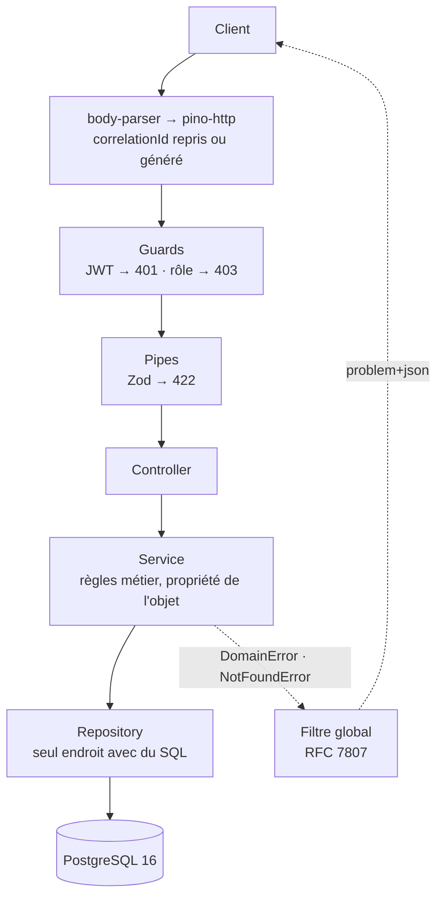
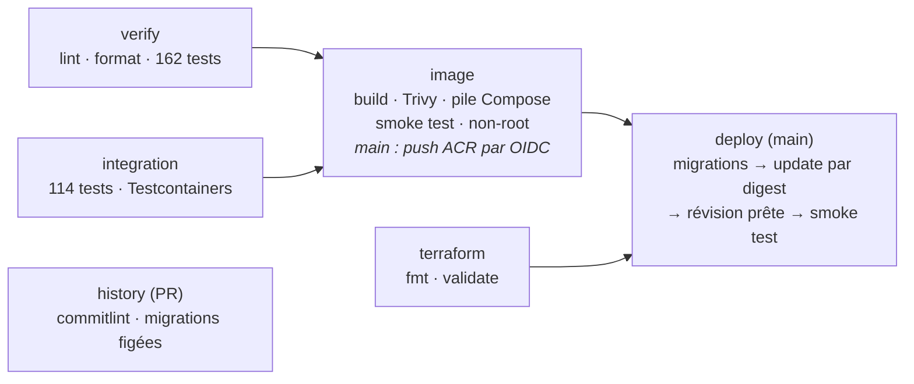
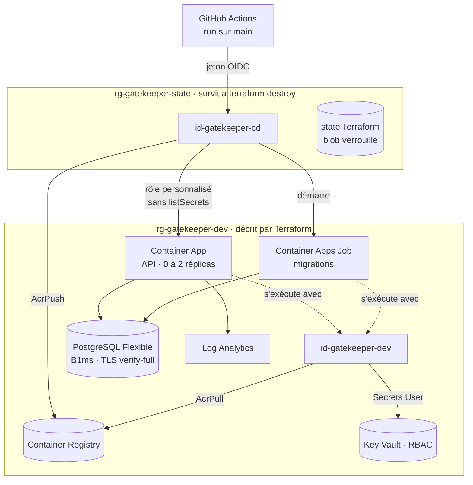

# GateKeeper

**API de réservation d'événements, dans laquelle un siège ne peut jamais être vendu deux fois, même sous concurrence. Elle est livrée sur Azure par un pipeline qui ne stocke aucun secret.**

[](https://github.com/omarhss-dev/prj-gatekeeper/actions/workflows/ci.yml)


Dans GateKeeper, un organisateur crée un événement découpé en sections, puis le publie, ce qui génère les sièges. Les clients consultent le catalogue et le plan de salle, réservent de 1 à 10 sièges en une seule opération et reçoivent un billet par siège.

Le domaine est volontairement simple. L'exigence porte sur deux points :

1. **la correction sous concurrence**, garantie par la base de données et non par du code applicatif ;
2. **la chaîne de livraison** : image durcie, intégration continue bloquante, infrastructure décrite en code et déploiement continu sur Azure.

| Mesure                                                | Résultat                                                                                    |
| ----------------------------------------------------- | ------------------------------------------------------------------------------------------- |
| Réservations concurrentes croisées, en HTTP réel      | 50 courses `[A, B]` contre `[B, A]` → 50 × (`201` + `409`), aucun `500`, aucun interblocage |
| Tests                                                 | 162 unitaires · 114 d'intégration sur un vrai PostgreSQL                                    |
| Image de l'API                                        | ≈ 230 Mo (68 Mo compressés), utilisateur non-root                                           |
| Pipeline sur une PR / sur `main`, déploiement compris | 1 min 45 / 4 min 49                                                                         |
| Secrets stockés dans GitHub                           | aucun (authentification OIDC)                                                               |

---

## Le problème : vendre un siège une seule fois

La solution naïve consiste à lire l'état du siège, puis à écrire le billet :

```js
const { rows } = await pool.query("SELECT … WHERE seat_id = $1 AND active", [
  seatId,
]);
if (rows.length === 0) {
  await pool.query("INSERT INTO tickets …"); // une autre requête peut écrire entre ces deux lignes
}
```

Entre la lecture et l'écriture s'ouvre une **fenêtre de course**. Sous charge, deux requêtes la traversent ensemble et le siège est vendu deux fois.

## La solution : la base arbitre, le code traduit

```sql
-- Au plus un billet ACTIF par siège. Un billet annulé reste en base
-- sans bloquer la remise en vente : c'est le rôle du WHERE.
CREATE UNIQUE INDEX uq_tickets_active_seat
    ON tickets (event_seat_id) WHERE status = 'active';

-- Un seul aller-retour : le prix est calculé par la base, seuls les sièges
-- de CET événement sont retenus, et la cible du conflit est nommée.
INSERT INTO tickets (reservation_id, event_seat_id, code, price_cents)
SELECT $1, s.id, gen_random_uuid()::text, sec.price_cents
  FROM event_seats s JOIN event_sections sec ON sec.id = s.section_id
 WHERE s.id = ANY($2::uuid[]) AND s.event_id = $3
 ORDER BY s.id
ON CONFLICT (event_seat_id) WHERE status = 'active' DO NOTHING
RETURNING event_seat_id, code, price_cents;
```

Le déroulement est le suivant :

1. La seconde transaction **bloque** sur l'index jusqu'au `COMMIT` de la première.
2. Elle n'insère alors aucune ligne.
3. Le repository compare le nombre de billets insérés au nombre de sièges demandés.
4. S'il en manque, il annule toute la transaction et l'API répond `409 SEAT_UNAVAILABLE`, avec la liste exacte des sièges pris.

**Aucun verrou n'est écrit à la main.**

La cible du conflit, `(event_seat_id) WHERE status = 'active'`, compte : sans elle, `DO NOTHING` absorberait aussi une collision sur le code du billet, qui passerait pour un siège pris.

Le même principe s'applique à la publication d'un événement (`UPDATE … WHERE status = 'draft'`), à l'annulation et à l'inscription (`ON CONFLICT ON CONSTRAINT uq_users_email`).

> **Limite assumée :** l'index arbitre la course, mais il n'ordonne pas les attentes. Sous forte contention, rien ne garantit que le premier arrivé gagne. Il faudrait pour cela un verrou explicite ou une file d'attente.

---

## Architecture applicative



- **Trois couches qui ne se court-circuitent pas.** Un controller ne parle qu'à son service. Un service ne connaît ni HTTP ni SQL. Seul un repository exécute une requête (`grep -rn "pool.query\|client.query" apps/api/src` ne renvoie que `*.repository.js` et `database/`).
- **Chaque module est découpé en `http/` et `core/`** (contrôleurs, gardes et schémas d'un côté ; services et repositories de l'autre), et `core/` n'importe jamais `http/`.
- **L'autorisation se fait en deux temps.** Le garde vérifie le _type_ d'action à partir du jeton, puis le service vérifie la _propriété_ de l'objet. Ce qui est invisible pour l'appelant répond `404`, pas `403`, pour ne pas révéler qu'il existe.
- **Les transactions vivent dans le repository**, par une fonction `withTransaction` d'une vingtaine de lignes plutôt qu'un Unit of Work.
- **Pas d'architecture hexagonale.** Son bénéfice est de pouvoir remplacer l'infrastructure, or l'invariant central de ce projet _est_ un index PostgreSQL. Une couche de ports prétendant le contraire serait une abstraction qui ment.

### Ce qui ne sort jamais vers le client

Toutes les erreurs suivent le format `application/problem+json` (RFC 7807) et portent un `correlationId`, renvoyé aussi dans l'en-tête `X-Correlation-Id`. Aucune trace d'exécution, aucun message PostgreSQL et aucun nom de table ne franchit la frontière HTTP.

```json
{
  "type": "https://gatekeeper.dev/errors/seat-unavailable",
  "title": "Seat unavailable",
  "status": 409,
  "code": "SEAT_UNAVAILABLE",
  "detail": "Sièges indisponibles : 1 sur 2.",
  "seatIds": ["5b0e…"],
  "correlationId": "c3a1…"
}
```

Sept codes métier existent : `SEAT_UNAVAILABLE`, `SALES_NOT_OPEN`, `EVENT_NOT_AVAILABLE`, `EVENT_ALREADY_PUBLISHED`, `MAX_SEATS_EXCEEDED`, `RESERVATION_NOT_CANCELLABLE` et `EMAIL_ALREADY_REGISTERED`.

---

## API

Les routes métier sont servies sous `/api/v1`. Les sondes restent à la racine, là où la plateforme les interroge.

| Méthode  | Route                                         | Accès                                | Réponses                          |
| -------- | --------------------------------------------- | ------------------------------------ | --------------------------------- |
| `POST`   | `/api/v1/auth/register`                       | public                               | 201 · 409 · 422                   |
| `POST`   | `/api/v1/auth/login`                          | public                               | 200 · 401 · 422                   |
| `GET`    | `/api/v1/me`                                  | authentifié                          | 200 · 401                         |
| `GET`    | `/api/v1/events?page=&limit=&city=&from=&to=` | public                               | 200 · 422                         |
| `GET`    | `/api/v1/events/:id`                          | public                               | 200 · 404                         |
| `GET`    | `/api/v1/events/:id/seats`                    | public                               | 200 · 404                         |
| `POST`   | `/api/v1/events`                              | organisateur                         | 201 · 401 · 403 · 422             |
| `PATCH`  | `/api/v1/events/:id`                          | organisateur propriétaire, brouillon | 200 · 401 · 403 · 404 · 409 · 422 |
| `POST`   | `/api/v1/events/:id/publish`                  | organisateur propriétaire            | 200 · 401 · 403 · 404 · 409       |
| `POST`   | `/api/v1/reservations`                        | authentifié                          | 201 · 401 · 404 · 409 · 422       |
| `DELETE` | `/api/v1/reservations/:id`                    | propriétaire (idempotent)            | 204 · 401 · 404 · 409             |
| `GET`    | `/api/v1/me/reservations`                     | authentifié                          | 200 · 401                         |
| `GET`    | `/health/live`                                | plateforme                           | 200, ne teste rien                |
| `GET`    | `/health/ready`                               | plateforme                           | 200 · 503, teste PostgreSQL       |

La sonde _liveness_ ne teste aucune dépendance. Si elle testait la base, une panne de base ferait redémarrer toutes les instances en boucle, et une dégradation deviendrait une panne totale. La sonde _readiness_ teste PostgreSQL : son échec retire l'instance de la répartition de charge sans la redémarrer.

---

## Chaîne de livraison



| Job           | Quand        | Ce qu'il garantit                                                                                                                                    |
| ------------- | ------------ | ---------------------------------------------------------------------------------------------------------------------------------------------------- |
| `verify`      | PR et `main` | linter, formatage et tests unitaires                                                                                                                 |
| `integration` | PR et `main` | tests d'intégration sur un PostgreSQL neuf, avec les vraies migrations                                                                               |
| `history`     | PR           | messages de commit conformes, migrations déjà fusionnées inchangées                                                                                  |
| `image`       | PR et `main` | image construite et scannée par Trivy (échec sur HIGH/CRITICAL corrigeable), pile complète démarrée, route métier testée, utilisateur `node` vérifié |
| `terraform`   | PR et `main` | configuration formatée et valide                                                                                                                     |
| `deploy`      | `main`       | migrations, nouvelle révision par digest, attente de la révision prête, smoke test                                                                   |

Les cinq premiers jobs sont **obligatoires** dans les règles de protection de `main` : aucune fusion n'est possible tant que l'un d'eux échoue.

**Les choix à retenir :**

- **Build once.** L'image déployée est celle qui a été scannée et testée, jamais reconstruite. Elle est poussée avec un tag (le SHA du commit) pour les humains et déployée **par digest**, car un tag peut être réécrit.
- **On n'attend pas le retour de `az containerapp update`.** Il rend la main avant que la nouvelle révision soit prête. Le job attend que `latestReadyRevisionName` désigne la révision créée, puis teste `/api/v1/events`, car `/health/ready` répond 200 même sur une base vide.
- **Les migrations s'exécutent dans un job Container Apps**, avant le nouveau code et jamais au démarrage de l'API. Elles sont _forward-only_ : chaque `down` lève une exception.
- **Le rollback est manuel.** Avant toute modification, le job écrit dans le résumé du run l'image en place et la commande exacte pour y revenir. Une révision qui ne passe pas ses sondes ne reçoit jamais de trafic : ce comportement a été mesuré.
- **La chaîne d'approvisionnement est verrouillée.** Les actions GitHub sont épinglées par SHA, Dependabot propose les mises à jour sous forme de PR, et les exceptions Trivy sont limitées à leur chemin et datées.

---

## Infrastructure Azure



**Le principe de droits :** la CD peut changer l'image mais ne peut lire aucun secret ; l'application peut lire ses secrets mais ne peut rien déployer.

- **Aucun secret dans GitHub.** GitHub signe un jeton OIDC pour chaque run, et Microsoft Entra ne l'accepte que pour la branche `main` de ce dépôt. Les trois identifiants (`AZURE_CLIENT_ID`, `AZURE_TENANT_ID`, `AZURE_SUBSCRIPTION_ID`) sont des _variables_ de dépôt et non des secrets : sans ce jeton, ils ne donnent rien.
- **Un rôle personnalisé pour la CD.** Les rôles intégrés de Container Apps incluent `listSecrets`, et il a été mesuré que cette action renvoie les valeurs _résolues_ des références Key Vault. Avec ces rôles, la CD aurait pu lire le mot de passe de la base.
- **Aucune valeur de secret dans le state Terraform.** Les secrets sont générés par des ressources `ephemeral` et écrits par des arguments _write-only_. Cela a été vérifié par une recherche négative, avec un contrôle positif.
- **Un environnement jetable.** `terraform destroy` puis `apply` reconstruit tout, sans action dans le portail. Le state et l'identité de la CD vivent dans un groupe de ressources séparé, que la destruction ne touche pas.
- **Un budget de connexions calculé.** Un serveur B1ms offre environ 35 connexions utilisables. Avec 2 réplicas × un pool de 10, plus 1 pour la migration, le besoin est de 21. Le pic mesuré pendant une bascule sous charge est de 13 connexions.

Le guide d'installation de l'infrastructure (bootstrap du state, prérequis, accès SQL temporaire) se trouve dans [`infra/README.md`](infra/README.md).

---

## Démarrer en local

**Prérequis :** Docker avec Compose v2. Node 26 (`.nvmrc`) n'est nécessaire que pour lancer les tests hors conteneur.

```bash
git clone https://github.com/omarhss-dev/prj-gatekeeper.git && cd prj-gatekeeper
cp .env.example .env
# JWT_SECRET est vide par défaut : l'API refuse de démarrer sans lui (au moins 32 caractères).
sed -i "s/^JWT_SECRET=.*/JWT_SECRET=$(openssl rand -hex 32)/" .env

docker compose up -d --build
curl --retry 30 --retry-delay 2 --retry-all-errors -fsS localhost:3000/health/ready
```

Au démarrage, `docker compose up` enchaîne trois étapes :

1. PostgreSQL démarre et devient sain.
2. Le service `migrate` applique les migrations, puis s'arrête.
3. L'API démarre ensuite.

Les ports sont liés à `127.0.0.1` uniquement. Si le port 5432 est déjà pris sur la machine, changez `DB_PORT` (et le port de `DATABASE_URL`) dans `.env`.

### Parcours de démonstration

Ce parcours nécessite `jq`.

```bash
API=localhost:3000/api/v1
json='Content-Type: application/json'

# 1. Un organisateur : inscription, puis promotion par SQL (aucune route d'administration n'est exposée)
curl -fsS -H "$json" $API/auth/register \
  -d '{"email":"orga@example.com","password":"motdepasse-orga","displayName":"Orga"}' > /dev/null
docker compose exec -T postgres psql -U gatekeeper -d gatekeeper \
  -c "UPDATE users SET role = 'organizer' WHERE email = 'orga@example.com';"
# Le rôle est lu dans le jeton : se connecter APRÈS la promotion
ORGA=$(curl -fsS -H "$json" $API/auth/login \
  -d '{"email":"orga@example.com","password":"motdepasse-orga"}' | jq -r .accessToken)

# 2. Créer un brouillon, puis le publier (les sièges sont générés à ce moment-là)
EVENT=$(curl -fsS -H "$json" -H "Authorization: Bearer $ORGA" $API/events -d '{
  "name":"Concert de démonstration","city":"Fès","venue":"Salle A",
  "startsAt":"2030-06-01T20:00:00Z","salesOpenAt":"2026-01-01T00:00:00Z",
  "sections":[{"name":"Orchestre","priceCents":15000,"rowsCount":5,"seatsPerRow":10}]
}' | jq -r .id)
curl -fsS -X POST -H "Authorization: Bearer $ORGA" $API/events/$EVENT/publish > /dev/null

# 3. Un client réserve deux sièges
curl -fsS -H "$json" $API/auth/register \
  -d '{"email":"client@example.com","password":"motdepasse-client","displayName":"Client"}' > /dev/null
CLIENT=$(curl -fsS -H "$json" $API/auth/login \
  -d '{"email":"client@example.com","password":"motdepasse-client"}' | jq -r .accessToken)
SEATS=$(curl -fsS $API/events/$EVENT/seats | jq -c '[.sections[0].seats[0:2][].id]')
BODY=$(jq -nc --arg e "$EVENT" --argjson s "$SEATS" '{eventId: $e, seatIds: $s}')

curl -sS -H "$json" -H "Authorization: Bearer $CLIENT" $API/reservations -d "$BODY" | jq   # 201
curl -sS -H "$json" -H "Authorization: Bearer $CLIENT" $API/reservations -d "$BODY" | jq   # 409 SEAT_UNAVAILABLE
```

### Tests

Les scripts vivent dans le workspace `apps/api`.

```bash
npm ci
npm run lint -w apps/api
npm test -w apps/api           # tests unitaires : fonctions pures, services, gardes (sans Docker)
npm run test:db -w apps/api    # tests d'intégration : PostgreSQL neuf via Testcontainers (Docker requis)
```

Les tests d'intégration démarrent un PostgreSQL 16 jetable, y appliquent les vraies migrations, puis exécutent :

- les repositories ;
- des parcours HTTP complets ;
- des tests de concurrence réels sur la réservation, la publication et l'annulation.

Un test qui remplace le repository par un faux ne teste jamais la requête SQL, alors que c'est elle qui porte l'invariant.

Les mesures de performance se rejouent avec les scripts `apps/api/scripts/*-explain.sql`. Par exemple, l'index du catalogue fait passer la requête de 23 ms à 0,07 ms sur 100 000 événements. Chaque script annule ses données à la fin par `ROLLBACK`.

---

## Structure du dépôt

```
.
├── apps/api/
│   ├── src/
│   │   ├── config/          # schéma Zod de la configuration, validée au démarrage (fail-fast)
│   │   ├── common/          # erreurs et filtre RFC 7807, corrélation, validation
│   │   ├── database/        # pool pg, withTransaction, ping du readiness
│   │   └── modules/         # health · auth · events · reservations, chacun en http/ + core/
│   ├── migrations/          # SQL écrit à la main, forward-only (node-pg-migrate)
│   ├── scripts/             # mesures EXPLAIN ANALYZE rejouables
│   └── test/db/             # tests d'intégration (Testcontainers)
├── infra/                   # Terraform (azurerm) et scripts de bootstrap du state et de la CD
├── .github/                 # workflow CI/CD, Dependabot
├── Dockerfile               # multi-étapes : build → runtime (non-root) et migrate
└── docker-compose.yml       # postgres → migrate → api
```

## Stack

| Brique                                                             | Problème qu'elle résout                                                                        |
| ------------------------------------------------------------------ | ---------------------------------------------------------------------------------------------- |
| NestJS 12, JavaScript (ESM)                                        | Modules, injection de dépendances et cycle de vie des requêtes, sans les réécrire              |
| PostgreSQL 16 + `pg`, sans ORM                                     | Les invariants vivent dans le schéma ; chaque requête qui les porte est écrite et lue en clair |
| node-pg-migrate                                                    | Migrations SQL versionnées, appliquées hors du démarrage                                       |
| Zod                                                                | Une seule description pour la configuration et les entrées HTTP                                |
| argon2 (Argon2id, paramètres OWASP) · jose (HS256 imposé)          | Mots de passe et jetons, sans option laissée ouverte par défaut                                |
| pino / nestjs-pino                                                 | Journaux JSON corrélés par requête, en-têtes d'authentification masqués                        |
| Jest · Testcontainers                                              | Tests unitaires, et tests d'intégration sur une vraie base                                     |
| Docker · GitHub Actions · Trivy · Dependabot                       | Image reproductible, contrôles bloquants, analyse des vulnérabilités                           |
| Terraform · Azure Container Apps · Key Vault · PostgreSQL Flexible | Infrastructure jetable et décrite en code, sans cluster à opérer                               |

---

## Limites connues

Ce que le projet ne fait pas encore, dans l'ordre où je le reprendrais :

- **Pas de limitation de débit** sur `/auth/*`, alors que chaque tentative de connexion réserve 19 Mio pour Argon2. **Pas d'en-têtes de sécurité HTTP** (helmet).
- **Pas de clé d'idempotence** : un client qui renvoie sa réservation après un délai dépassé reçoit `409` sur ses propres sièges.
- **Rollback manuel** et pas de règle _expand / contract_ sur les migrations, ce qui serait le prérequis d'un rollback automatique.
- **Base accessible publiquement derrière un pare-feu**, avec une seule règle permanente, « services Azure ». Un sous-réseau délégué serait l'étape suivante.
- **Démarrage à froid d'environ 25 s** sur Azure : l'application descend à zéro réplica pour limiter le coût.
- **Redis est présent dans le Compose, mais il n'est pas branché.** Il ne sera conservé que si une mesure montre un gain sur le catalogue, qui répond déjà en 0,07 ms côté base.
- **Ni réservation temporaire avec expiration, ni paiement, ni jeton de rafraîchissement** : ils ont été exclus du périmètre, chacun pour une raison nommée.

## Auteur

**Omar El-Hassouni** — étudiant ingénieur en informatique, orienté DevOps, Cloud et Backend.
